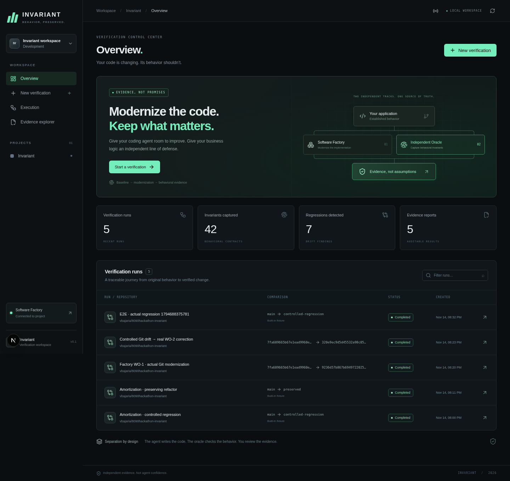

# INVARIANT

**8090 manufactures the software. INVARIANT independently verifies its behavioral integrity.**

A working Next.js verification workspace with real 8090 work orders, immutable Git checkouts, an independent Python/pytest/Hypothesis oracle, SQLite persistence, reproducible evidence, and actionable remediation.



## Run locally

Requires Node 22+, Python 3.11+ (tested on 3.13), Git, and a trusted single-user machine. SQLite is embedded; no database service is needed.

```sh
npm ci
python3 -m venv .venv
.venv/bin/pip install -r requirements.lock.txt
cp .env.example .env.local
# Configure server-only values in .env.local; never commit this file.
npm run dev
```

Open `http://localhost:3000` (or the port supplied by `PORT`; this Factory workspace uses port 80). Workspace setup/startup is declared in `.8090/environment.json`.

The two built-in financial fixtures work **without credentials** and execute real tests. Choose **Detect a regression** or **Verify preserved behavior**, create a run, then inspect/download the evidence.

For a production build:

```sh
npm run build
npm start
```

Deploy the full application checkout with Node, Python, `.venv`, Git, and a persistent `.runtime` directory. This is a long-running Node application, **not a stateless/serverless or static export**. Do not rely on a Next standalone bundle to contain the external Python runtime.

## Launch locally with Docker

Requires only **Docker Desktop** (or Docker Engine with the Compose plugin v2.20+). Bash scripts work on macOS/Linux and Windows via WSL/Git Bash. Node, Python and SQLite dependencies are installed inside the image.

```sh
./scripts/docker.sh up
```

Open **http://localhost:3000**. The first launch builds the image and creates a private, ignored `.env.docker`; the built-in demos work without an API key. The script waits for the application and SQLite to become healthy.

```sh
./scripts/docker.sh status  # readiness and published port
./scripts/docker.sh logs    # follow logs; Ctrl-C only stops following
./scripts/docker.sh smoke   # two REAL verification runs + report checks; no external work orders
./scripts/docker.sh down    # stop containers, KEEP all data
./scripts/docker.sh up      # rebuild/relaunch; existing data remains
```

To connect 8090, configure an optional Basic-auth password, or use another host port, edit `.env.docker` (not the Dockerfile):

```dotenv
INVARIANT_HOST_PORT=3000
FACTORY_API_KEY=<your project-scoped External API key>
FACTORY_PROJECT_ID=<matching project UUID>
INVARIANT_PASSWORD=
ALLOW_REPOSITORY_EXECUTION=false
```

Keys/passwords are supplied **only at container runtime**, never baked into an image or build argument. Use single quotes around values containing `$`, and keep the file private (`chmod 600 .env.docker`). After changing settings, run `./scripts/docker.sh up` to apply them. A configured password uses username `invariant`.

### Direct Compose / Windows PowerShell

The lifecycle script records the actual source revision and dirty-build indicator without including `.git` in the image. You can also use Compose directly:

```sh
# Copy .env.docker.example to .env.docker, then edit it if needed.
docker compose --env-file .env.docker up --build --detach --wait
docker compose --env-file .env.docker logs --follow
docker compose --env-file .env.docker down
```

Without source metadata, direct builds **explicitly report an unversioned image**, not a fabricated Git revision. For revision-tagged PowerShell builds, set `$env:INVARIANT_SOURCE_COMMIT = git rev-parse HEAD` and set `$env:INVARIANT_SOURCE_DIRTY` to `true` or `false` according to `git status --porcelain` before the Compose build. Recorded source hashes still identify the actual Python files executed.

### Data, configuration and safety

- One non-root container contains the compiled Next app, Python oracle, Git and native SQLite. It binds **only `127.0.0.1`** by default. This is a predictable local launch, not a hot-reload source bind mount; re-run `up` after code changes.
- The named `invariant_invariant-data` volume persists SQLite, captured checkouts and reports at `/app/.runtime`. Ordinary `down`, `restart` and rebuilds do not remove it. **Do not use `docker compose down --volumes` unless you intentionally want to erase all runs/evidence.**
- To run a separate instance/test volume, set `COMPOSE_PROJECT_NAME`; to select a different environment file, set `INVARIANT_DOCKER_ENV_FILE` when using the script. Adjust its host port to avoid collisions.
- The image excludes host `.env*`, `.git`, `.runtime`, virtualenvs and `node_modules`; it never mounts the host Docker socket. No key is needed for health/readiness or offline demo verification.
- Docker packaging is **not a hostile-code sandbox**. Keep repository execution disabled unless you have reviewed and trust the target. Containers with Docker-daemon access or the same-user process/filesystem access are not an independent security boundary for secrets.
- If port 3000 is in use, change `INVARIANT_HOST_PORT`. If Docker is not running, start Docker Desktop. If startup fails, inspect `./scripts/docker.sh logs` and `status`.

## Connect the real 8090 project

Set these **server-side** environment variables:

```dotenv
FACTORY_API_KEY=<project-scoped External API key>
FACTORY_PROJECT_ID=<project UUID>
```

Create the key in **Settings → API Keys → External API**. INVARIANT verifies `/health` and uses only [documented REST operations](https://docs.8090.ai/api-reference):

- `GET /health`
- `GET /skills/work_orders_writing_rules`
- `POST /work_orders/batch_create` (`CreateWorkOrder`, title only)
- `PATCH /work_orders/{id}/description` (`markdown_content`)
- `GET /work_orders/{id}` and `/work_orders/{id}/pull_requests`
- `GET /requirements/{id}` and `/blueprints/{id}`

Creation identities are persisted before attaching descriptions; failed attachment is recoverable through **Sync artifacts**, without silently creating duplicate work orders. Linked artifacts/statuses come from the actual run's work order, not unrelated project documents. Existing modernization and remediation orders can be associated instead of duplicated.

**Native artifact generation is not an invented REST operation.** Use the 8090 project agent to generate/link requirements and blueprints. **Launch Coding Agent** copies explicit handoff instructions; it does not pretend to dispatch an agent. External coding agents connect to `https://api.factory.8090.dev/v2/mcp`, with `X-Sofa-Mcp-Project-Id`, and complete browser OAuth separately. See the [official connection guide](https://docs.8090.ai/connections/connect-coding-agent).

## Verify a real repository

1. Review the repository. Only on a trusted local deployment set `ALLOW_REPOSITORY_EXECUTION=true`.
2. The repository must expose `invariant_adapter.py` with the documented financial `calculate(principal, annual_rate, months, prepayment=0)` contract. This repository includes a real baseline adapter.
3. Create a **Your repository** run with HTTPS GitHub URL and baseline/candidate branches or commits. INVARIANT resolves immutable commits and executes the original baseline first.
4. Submit a modernization work order or associate an existing one. Use native 8090 generation and an authenticated coding agent; sync actual linked context and PR status.
5. Enter the resulting candidate commit and **Run verification**. Both versions execute independently of the coding agent's tests.
6. Inspect minimized counterexamples, classifications, source locations, original/new outputs, and JSON/Markdown evidence. Create or associate remediation, select the correction commit, and re-run the full suite.

The current oracle is intentionally scoped to the financial amortization contract. **This is not automatic verification of arbitrary business domains.** Other domains require a new explicit adapter/policy/reference implementation, not guessed semantics. Target repository dependencies are not auto-installed.

### Actual Git workflow exercised

| Version | Immutable commit | Independent result | Pull request |
|---|---|---|---|
| Original baseline | `7fa609665b67e1ead9960e1a8946f6442df8f03a` | Captured and executed | Application baseline |
| Agent modernization | `9236d57b867b69497220251e9f99671ea575b141` | **VERIFIED**, 156 case assessments | [#2](https://github.com/vbajaria/8090hackathon-invariant/pull/2) |
| Explicit controlled regression | `2ced874262abbd504f78e27e47902af590fe9037` | **DRIFT DETECTED**, shrunk counterexample | [Draft #3 — NOT FOR MERGE](https://github.com/vbajaria/8090hackathon-invariant/pull/3) |
| WO-2 correction | `320e9ec9d5d45532a98c05b3655ee357934fc86f` | **VERIFIED**, 156 case assessments | [#4](https://github.com/vbajaria/8090hackathon-invariant/pull/4) |

The app retrieved and verified these **remote commits**, not just local fixture labels. Native Factory tools created and linked the real [financial requirement](https://factory.8090.ai/project/111f2375-bea8-4c31-8eb4-dca7f3398144/requirements/a1b62fcf-5c16-4703-92bd-2ccde7db817a), [blueprint](https://factory.8090.ai/project/111f2375-bea8-4c31-8eb4-dca7f3398144/blueprints/d9f4d308-43c4-4426-822b-9c18d24ce6cb), [WO-1](https://factory.8090.ai/project/111f2375-bea8-4c31-8eb4-dca7f3398144/work-orders/1), and [WO-2](https://factory.8090.ai/project/111f2375-bea8-4c31-8eb4-dca7f3398144/work-orders/2). The native authenticated Factory coding subagent implemented the changes; **an external OAuth/MCP session was not exercised**. The initial verification was performed before any merge or approval. Later release merges require explicit user authorization; see the decision log. Native document content awaits project review.

## Independent evidence

- Real pytest golden, boundary, invalid-input, precision, Hypothesis property and metamorphic executions against **both** versions.
- Independent 60-digit Decimal financial reference. A baseline defect requires review, rather than being preserved blindly.
- `MUST_PRESERVE`, `INTENTIONAL_CHANGE`, `UNKNOWN`. Intentional classification is not approval; unknown policies require review.
- Hypothesis search/shrinking with reproducible inputs. Minimality is within the configured strategy/budget, not a global mathematical claim.
- Separate persistent Python workers prevent cross-revision module-cache contamination; they compile captured source and fresh checkout-owned dependency source, strip integration credentials, and record dependency hashes.
- Incomplete tests, infrastructure failures, source/dependency mutation, and baseline defects cannot silently become verified.
- Verdicts: **BEHAVIORAL INTEGRITY: VERIFIED**, **BEHAVIORAL DRIFT: DETECTED**, **REVIEW REQUIRED**. Finite tests are evidence, **not formal proof or complete equivalence**.
- Reports include exact inputs/results, reference outputs, source locations, hashes, immutable commits, package versions, verifier-source hashes, pytest transcript, audit events, and remediation history. Re-verification clears stale current evidence; append-only report files are retained.

[Oracle policies, adapter contract and CLI](docs/ORACLE.md) · [Decision log](docs/DECISIONS.md)

## Verification commands

GitHub Actions CI is disabled and its workflow has been removed by request. Tests and verification tools remain available to run locally.

```sh
npm run typecheck
npm test                         # backend/API/security + real Python orchestration
npm run test:oracle              # adversarial oracle tests
npx playwright install chromium # one-time browser dependency
npm run test:e2e                 # real UI → real oracle → downloadable reports
npm run build
```

The browser suite does not create external work orders or simulate oracle outcomes. Financial modernization PR #2 also has 48 unit tests and strict mypy verification; correction PR #4 has 8 focused tests.

## Security and operational boundaries

- **Python repository execution is not a sandbox.** Separate workers isolate imports, not filesystem/network/process permissions. Only execute code you trust; default repository execution is disabled. Process groups have bounded time/output and receive no Factory/GitHub credentials.
- Before any shared/public exposure, set `INVARIANT_PASSWORD`; the browser uses HTTP Basic authentication, username `invariant`. Use HTTPS. This is a single-operator application, not enterprise multi-tenant authentication.
- Keep API keys in server environment variables or an ignored, permission-restricted `.env.local`; never in client code, reports, Git, or screenshots. Rotate any key disclosed in chat after development.
- Mutating API routes reject cross-origin requests, require JSON, limit body size, validate GitHub URLs/refs, and invoke subprocesses with argument arrays rather than shell interpolation.
- API keys are project-scoped; configure the matching project UUID. INVARIANT does not invent a project-list endpoint.
- SQLite, captured checkouts and reports live in `.runtime` (override `INVARIANT_DATA_DIR`); back it up and restrict access. A server restart marks incomplete runs failed; incomplete evidence is never accepted. There is no durable distributed worker queue.
- Never auto-merge or approve modernization/remediation PRs. Review native Factory documents and final evidence yourself.
